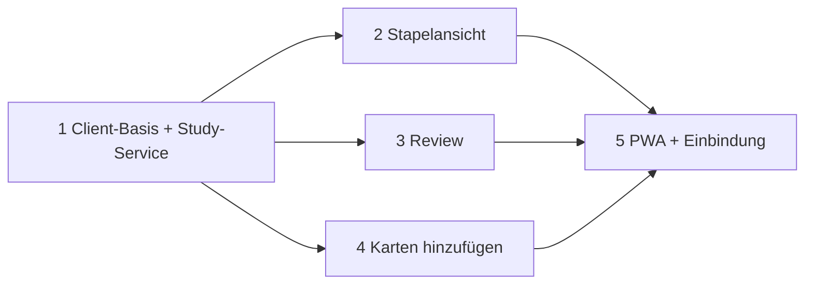

# Reviewer Redesign: Implementierungsplan (Übersicht)

Quelle: `design/reviewer-redesign/` (`DESIGN.md`, `REFERENCE.md`, 4x `RESEARCH-*.md`, Mockups, `study-api-spike.py`).
Dieses Dokument = Index, Entscheidungen, Abhängigkeiten. Details je Schritt in den Teilplänen.

| # | Plan | Ergebnis |
|---|---|---|
| 1 | [01-independent-client](2026-10-27-reviewer-redesign-01-independent-client.md) | Eigenes Paket `/app/*`, Shell, Design-Tokens, Study-Service, Auth, Tests-Fixtures |
| 2 | [02-deck-list](2026-10-27-reviewer-redesign-02-deck-list.md) | `GET /app/` Stapelansicht (Suche, Zähler, Learn / Edit-Add) |
| 3 | [03-review-flow](2026-10-27-reviewer-redesign-03-review-flow.md) | `/app/review` Queue, Reveal, Rating, Streak, Actions-Sheet |
| 4 | [04-add-cards](2026-10-27-reviewer-redesign-04-add-cards.md) | `/app/add` Wizard, Stapel, Note-Type `AnkiWeb Vocab`, Edit-last |
| 5 | [05-pwa-bootstrap](2026-10-27-reviewer-redesign-05-pwa-bootstrap.md) | Einbindung aller Views, Manifest/SW auf `/app/`, Navigation, Doku |

## Festgelegte Entscheidungen

| Entscheidung | Wahl | Begründung |
|---|---|---|
| Client-Technik | **Jinja + Datastar**, eigene Routen, kein SPA | RESEARCH-independent-client §6: offline kein Ziel, Server hält gerenderte Karten-HTML, gleiche Origin, Session-Cookie, kein CORS/Key-Thema. Passt zu `http_datastar/` |
| URL-Struktur | **Eigenes Präfix `/app/*`**, alter Client unter `/` unberührt | "unabhängig vom existierenden Client"; eigener SW-Scope möglich; keine Test-Brüche |
| Karteninhalt | Nur dedizierte Note-Types (`AnkiWeb Vocab`), **Server-gerendertes HTML** in Design-Container | DESIGN §5.F, RESEARCH §3a |
| Scheduler | Bleibt serverseitig (`get_queued_cards`, `answer_card`) | RESEARCH §4 |
| PWA | Eigener Code, **kein FastPWA** | RESEARCH-fastpwa §7 |
| Offline | Nicht im Scope | RESEARCH-pwa §5 Szenario 1/2 |

## Architekturregeln (aus Repo)

- Hexagonal: `ankiweb/core` importiert **nie** `ankiweb.adapters` (`tests/test_architecture_boundaries.py`).
- Neue Inbound-Adapter unter `ankiweb/adapters/inbound/http_app/` (neues Paket). Logik ohne FastAPI-Typen in `ankiweb/core/app_client/`.
- Collection-Zugriff nur über `service.run(fn)` (serialisiert, Executor).
- Router-Reihenfolge: spezifische Routen **vor** Media-Catch-All `/{path}` (`app.py`, `create_app`).
- Auth: `_auth_guard` schützt alles außer expliziten Ausnahmen. `/app/*` bleibt **geschützt**; nur Manifest und SW sind öffentlich.
- Ruff (preview, "correctness/suspicious/complexity/performance/style/security"), complexipy max 15, ty. Zeilenlänge 88.
- Datastar-Regeln (Skill): IDs auf allen gemorphten Elementen; `data-signals` im Scope jedes `data-init`/`data-on:*`; kein Block-Syntax (`if {}`) in Expressions; kein `localStorage` als State; `@post` für State-ändernde Calls; Fat-Morph.

## Abhängigkeitsgraph



Schritte 2, 3, 4 sind nach 1 unabhängig voneinander. Gemeinsame Dateien: `http_app/__init__.py` (Router-Aggregation), `templates/app/`, `app.css`-Tokens. Konflikte klein halten: jeder Schritt hängt **nur eine Zeile** an die Aggregation.

## Ziel-Dateistruktur

```
ankiweb/core/app_client/
  __init__.py
  decks.py            # DeckRow, deck_rows(col)             (Plan 2)
  study.py            # StudySession, next_card, answer, actions (Plan 3)
  vocab.py            # NOTETYPE, ensure_vocab_model, add_vocab_note, escape (Plan 4)
ankiweb/adapters/inbound/http_app/
  __init__.py         # build_app_router(get_service, settings)  (Plan 1)
  layout.py           # render_app_page(...)
  decks.py            # GET /app/                          (Plan 2)
  review.py           # GET /app/review, POST /app/review/* (Plan 3)
  add.py              # GET /app/add, POST /app/add/*       (Plan 4)
  templates/app/      # base.html.jinja + Seiten + Komponenten
ankiweb/shell/static/app/
  tokens.css          # Design-Tokens (hell/dunkel via prefers-color-scheme)
  app.css             # Komponenten
  card-render.js      # *word* -> <mark> (nur Plan 3/4)
tests/app_client/     # conftest + test_*.py je Schritt
```

## Verifikation je Schritt (Pflicht, nicht nur Tests)

1. `uv run pytest tests/app_client -q` plus komplette Suite vor Commit des Schritts.
2. `uv run ruff check . && uv run ruff format --check .`; `uv run complexipy`; ty.
3. **Smoke:** echten Server mit Wegwerf-Collection starten (`ANKIWEB_COLLECTION`, eigener `HOME`/`XDG_DATA_HOME`, Port ≠ 8000/8765), Seite im Headless-Chromium bei 375x812 öffnen, Interaktion ausführen, Screenshot prüfen. Wegwerf-Daten danach löschen.

## Commit-Strategie (iterativ, kurz)

Ein Commit je abgeschlossener, grüner Teilaufgabe (siehe "Commits" in jedem Plan). Nachrichten kurz, Imperativ, Englisch wie im Repo (`git log`). Kein Squash. Pläne selbst: ein Commit pro Plan-Dokument.

## Offene Produktfragen (nicht blockierend, vor Schritt 4/5 klären)

| Frage | Quelle | Default im Plan |
|---|---|---|
| Karten anderer Note-Types im neuen Client | RESEARCH §3a.2 | Ausblenden per Suche `note:"AnkiWeb Vocab"`; alter Client bleibt zugänglich |
| Queue-Filter bei gemischten Decks | RESEARCH §3a.3 | **ungeprüft**, siehe Plan 3 Spike-Task 0 |
| Enrichment (Hint/Example-Vorschläge) | RESEARCH-enrichment | **Out of scope** (nur Doku-Verweis) |
| Icon-Design | REFERENCE §7 | Platzhalter bleibt |
| HTTPS | RESEARCH-pwa §1 | Betriebsdoku, kein Code |
