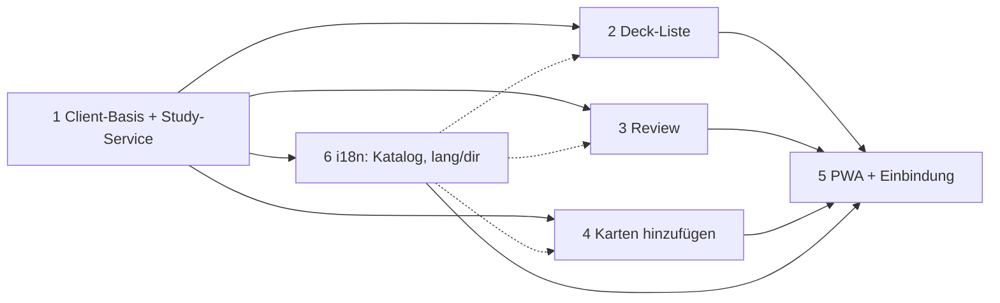

# Reviewer Redesign: Implementierungsplan (Übersicht)

Quelle: `design/reviewer-redesign/` (`DESIGN.md`, `REFERENCE.md`, 4x `RESEARCH-*.md`, Mockups, `study-api-spike.py`).
Dieses Dokument = Index, Entscheidungen, Abhängigkeiten. Details je Schritt in den Teilplänen.

| # | Plan | Ergebnis |
|---|---|---|
| 1 | [01-independent-client](2026-10-27-reviewer-redesign-01-independent-client.md) | Eigenes Paket `/app/*`, Shell, Design-Tokens, Study-Service, Auth, Tests-Fixtures |
| 2 | [02-deck-list](2026-10-27-reviewer-redesign-02-deck-list.md) | `GET /app/` Deck-Liste (Suche, Zähler, Learn / Edit-Add) |
| 3 | [03-review-flow](2026-10-27-reviewer-redesign-03-review-flow.md) | `/app/review` Queue, Reveal, Rating, Streak, Actions-Sheet |
| 4 | [04-add-cards](2026-10-27-reviewer-redesign-04-add-cards.md) | `/app/add` Wizard, Hinzugefügte Karten, Notiztyp `AnkiWeb Vocab`, Edit-last |
| 5 | [05-pwa-bootstrap](2026-10-27-reviewer-redesign-05-pwa-bootstrap.md) | Einbindung aller Views, Manifest/SW auf `/app/`, Navigation, Doku |
| 6 | [06-i18n](2026-10-27-reviewer-redesign-06-i18n.md) | Mehrsprachigkeit: Anki-Katalog plus kleiner eigener Katalog, `<html lang/dir>`, RTL, lokalisiertes Manifest |

## Festgelegte Entscheidungen

Begriffe: [`CONTEXT.md`](../../../CONTEXT.md) (Deck, Deck-Liste, Hinzugefügte Karten, Neue Karten = Anki-Zähler). Architekturentscheidung: [ADR 0001](../../adr/0001-mobile-client-separate-from-existing-client.md) (`/app/*` dauerhaft getrennt vom alten Client).

| Entscheidung | Wahl | Begründung |
|---|---|---|
| Client-Technik | **Jinja + Datastar**, eigene Routen, kein SPA | RESEARCH-independent-client §6: offline kein Ziel, Server hält gerenderte Karten-HTML, gleiche Origin, Session-Cookie, kein CORS/Key-Thema. Passt zu `http_datastar/` |
| URL-Struktur | **Eigenes Präfix `/app/*`**, alter Client unter `/` unberührt | "unabhängig vom existierenden Client"; eigener SW-Scope möglich; keine Test-Brüche |
| Styling | **Tailwind CSS 4 + daisyUI 5** (wie der restliche Client, `README.md`), eigener Build-Entry, eigene daisyUI-Themes, Utilities und daisyUI-Komponenten in den Jinja-Templates | Repo-Stack; Vertrag unten |
| Karteninhalt | Nur dedizierte Note-Types (`AnkiWeb Vocab`), **Server-gerendertes HTML** in Design-Container | DESIGN §5.F, RESEARCH §3a |
| Scheduler | Bleibt serverseitig (`get_queued_cards`, `answer_card`) | RESEARCH §4 |
| PWA | Eigener Code, **kein FastPWA** | RESEARCH-fastpwa §7 |
| Offline | Nicht im Scope | RESEARCH-pwa §5 Szenario 1/2 |

## Architekturregeln (aus Repo)

- Hexagonal: `ankiweb/core` importiert **nie** `ankiweb.adapters` (`tests/test_architecture_boundaries.py`).
- Neue Inbound-Adapter unter `ankiweb/adapters/inbound/http_app/` (neues Paket). Logik ohne FastAPI-Typen in `ankiweb/core/app_client/`.
- Collection-Zugriff nur über `service.run(fn)` (serialisiert, Executor).
- Router-Reihenfolge: spezifische Routen **vor** Media-Catch-All `/{path}` (`app.py`, `create_app`).
- Auth: `_auth_guard` schützt alles außer expliziten Ausnahmen. `/app/*` bleibt **geschützt**; nur Manifest und SW sind öffentlich.
- Ruff (preview, "correctness/suspicious/complexity/performance/style/security"), complexipy max 15, ty. Zeilenlänge 88.
- Datastar-Regeln (Skill): IDs auf allen gemorphten Elementen; `data-signals` im Scope jedes `data-init`/`data-on:*`; kein Block-Syntax (`if {}`) in Expressions; kein `localStorage` als State; `@post` für State-ändernde Calls; Fat-Morph.

## Styling-Vertrag (gilt für alle Pläne)

Belegt im Repo: Tailwind 4.3.3 + daisyUI 5.7.47 (`package.json`); `shell_src/app.css` hat `@source "../ankiweb"`, scannt also neue Jinja-Templates automatisch; `ankiweb/shell/static/*` ist gitignoriert (Build-Artefakt, `npm run build`); das alte `app.css` kennt nur die Themes `light`/`dark` und `bootstrap.js` setzt `data-theme` per `localStorage`.

| Punkt | Vorgabe |
|---|---|
| Entry | Neu `shell_src/app-client.css` → `ankiweb/shell/static/app-client.css`. Eigener Entry statt Erweiterung von `app.css`, damit `/app/*` weder `app.css`, `theme.css`, `components.css` noch `bootstrap.js` lädt (Isolation aus Plan 1) und alte Seiten keine neuen Regeln bekommen |
| Build | `package.json`: Skript `build:css:app` (`tailwindcss -i shell_src/app-client.css -o ankiweb/shell/static/app-client.css --minify`), in `build` angehängt. Kein neues Tool |
| Quellen | `@source "../ankiweb/adapters/inbound/http_app"`, `@source "../ankiweb/adapters/inbound/http_shared/templates/app"`, `@source "../ankiweb/shell/static/app"` (JS mit Klassennamen). Klassen **nie** per String-Konkatenation bauen (Tailwind erkennt nur vollständige Namen); dynamische Varianten über vollständige Map im Template/Python |
| Themes | Zwei eigene daisyUI-Themes per `@plugin "daisyui/theme"`: `aw-light` (`default: true`) und `aw-dark` (`prefersdark: true`). `@plugin "daisyui" { themes: false; }`, damit nur diese zwei ausgeliefert werden. **Verifiziert:** Der Compile erzeugt `@media (prefers-color-scheme: dark) { :root:not([data-theme]) {…} }`. `/app/*` setzt **kein** `data-theme`, braucht kein Inline-JS und hat keinen Toggle (DESIGN §6) |
| Tokens | Mockup-Werte werden daisyUI-Variablen: `--color-base-100` (#f4f3ed), `--color-base-200/300`, `--color-base-content` (#18191f), `--color-primary`, `--color-accent` (#ffd13b), `--color-info/success/warning/error` für Easy/Good/Hard/Again, `--radius-box` (24px), `--radius-field` (16px), `--border` (2.5px). Kontrast ≥ 4.5:1 wie in `REFERENCE.md` §3: **Werte aus dem Mockup übernehmen, nicht neu wählen**; Prüfung per Messung (Plan 1, Aufgabe 1.0) |
| Komponenten | daisyUI zuerst: `btn`, `card`, `badge`, `progress`, `join`/`tabs` (Mode-Switch), `modal` (Summary, Sheet als `modal modal-bottom`), `toast`, `alert`, `input`/`textarea`, `collapse`/`details`, `menu`, `steps`/`step`. Tailwind-Utilities für Layout, Abstände, Typografie, Safe-Area (`pt-[env(safe-area-inset-top)]`), `motion-reduce:` |
| Eigenes CSS | Nur wo daisyUI/Utilities nichts abbilden, in `shell_src/app-client.css` unter `@layer components`: Hard-Shadow und Press-State (`.neo-press`), Candy-Stripe-Meter, Keyframes (`streakPop`, `streakReset`, `slideToAdded`, `popInFreshCard`, `addedPillPop`, `revealAnswer`), Karten-Klassen `.av-front-text`/`.av-hint`/`.av-back-text`/`.av-example` (Server-HTML, nicht im Template steuerbar, `@apply` erlaubt). Alles mit `motion-reduce` abgeschaltet. **Kein Block mit hartcodierten Hex-Farben**: Farben nur über Theme-Variablen |
| Ease-Kacheln | `btn` mit Farbe über `btn-error`/`btn-warning`/`btn-success`/`btn-info` plus `neo-press`. Mockup-Textfarben (`--ease-*-text`) werden `--color-*-content` der Themes |
| Datastar | `data-class`/`data-show` setzen **vollständige** Tailwind-Klassen. `data-show` immer mit `style="display:none"` (Gotcha #4). Tailwind `hidden` und `data-show` nicht mischen, sonst Konflikt um `display` |
| Alter Client | Unverändert. Test: `app.css`/`theme.css` nicht in `/app/*`-Seiten referenziert; `app-client.css` nicht in alten Seiten |
| Tests | `tests/test_shell_build.py`-Muster: Datei existiert, enthält `aw-light` und `aw-dark`; Template-Klassen-Test: jede in `http_app`-Templates verwendete Utility/daisyUI-Klasse ist im gebauten CSS vorhanden (fängt vergessene `@source` und String-Konkatenation) |
| Verifikation | Pro Seite Screenshot hell/dunkel bei 375x812 (`page.emulate_media(color_scheme=…)`), Vergleich mit Mockup-Screenshots; Kontrastmessung der Ease-Kacheln |

**Dunkelmodus (Entscheidung, bewusst abweichend vom alten Client):** Der alte Client setzt `data-theme` auf `<html>` immer selbst (`shell_src/bootstrap.ts:101-106`, `localStorage "ankiweb-night"`, Umschalter in der Toolbar). `/app/*` folgt **nur dem Betriebssystem** (`prefers-color-scheme`), ohne `bootstrap.js` und ohne Toggle (DESIGN §6). Folge: Wer im alten Client Nacht-Modus per Toggle gewählt hat, sieht in `/app/` das Theme des Betriebssystems, nicht seine Wahl. Das ist gewollt (Isolation aus Plan 1) und wird in `docs/pwa-deployment.md` und `README.md` vermerkt. Es gibt keine gemischte Quelle: `/app/*` setzt nie `data-theme`.

**Gemessen (Probe-Build, danach gelöscht):** Die `aw-*`-Themes stehen nur in `app-client.css`; das alte `app.css` enthält sie nicht, `app-client.css` wird in alten Seiten nie geladen. Der Fallback `@media (prefers-color-scheme: dark) { :root:not([data-theme]) }` kann dort ohnehin nicht greifen, weil der alte Client immer `data-theme` setzt. Eigene Komponenten-Klassen landen in `@layer components` (belegt im Build), also schlagen Utilities sie, wie es `tools/build_shell.mjs` für `shell_src/components/` vorsieht. `theme.css` bleibt für den alten Client unlayered und wird von `/app/*` nicht geladen.

**Repo-Randbedingungen, die der Plan bewusst ändert:**
- `README.md` sagt, Theming komme "only from daisyUI's built-in `light`/`dark` themes". Für `/app/*` gilt das nicht mehr (eigene Themes `aw-light`/`aw-dark`); die README-Zeile wird in Plan 5 (Aufgabe 5.5) angepasst, der alte Client behält `light`/`dark`.
- `ankiweb/shell/static/app-client.css` ist wie `app.css` gitignoriertes Build-Artefakt. Tests, die es brauchen, laufen nach `npm run build` (CI-Schritt); fehlt die Datei, schlägt der Build-Test mit dem Hinweis `run: npm run build` fehl, wie `tests/test_shell_build.py`. Kein stiller Test gegen ein altes Stylesheet.
- `Dockerfile` (geprüft): Die Frontend-Stage kopiert `package.json`, `tools/build_shell.mjs`, `shell_src/`, `ankiweb/` und ruft `npm run build`. Sobald `build:css:app` in `build` steht, landet `app-client.css` im Image ohne Dockerfile-Änderung. Neue JS-Dateien unter `shell_src/app/` sind durch `COPY shell_src/` abgedeckt. Ein Docker-Build-Test (Datei im Image vorhanden) ist Teil von 1.0.

Offene Abweichung vom Mockup: daisyUI-Komponenten haben eigene Geometrie. Pixelgleichheit ist **kein** Ziel; Ziel ist gleiche Wirkung (Farben, Rundungen, Hard-Shadow, Press). Abweichungen im Screenshot-Vergleich werden benannt, nicht versteckt.

## Abhängigkeitsgraph



Plan 6 legt `s()`, `<html lang/dir>` und die Test-Gates früh fest (nach Plan 1). Pläne 2 bis 4 verwenden von Anfang an `{{ tr.… }}`/`{{ s("…") }}` statt Klartext; nachträglich umstellen kostet einen Durchlauf pro Template. Plan 5 schließt Manifest, Offline-Seite und Cache-Hash ab.

Schritte 2, 3, 4 sind nach 1 unabhängig voneinander. Gemeinsame Dateien: `http_app/__init__.py` (Router-Aggregation), `templates/app/`, `app.css`-Tokens. Konflikte klein halten: jeder Schritt hängt **nur eine Zeile** an die Aggregation.

## Ziel-Dateistruktur

```
ankiweb/core/app_client/
  __init__.py
  decks.py            # DeckRow, deck_rows(col)             (Plan 2)
  study.py            # StudySession, next_card, answer, actions (Plan 3)
  vocab.py            # NOTETYPE, ensure_vocab_model, add_vocab_note, escape (Plan 4)
ankiweb/adapters/inbound/http_app/
  __init__.py         # build_app_router(get_service, settings)  (Plan 1)
  layout.py           # render_app_page(...)
  decks.py            # GET /app/                          (Plan 2)
  review.py           # GET /app/review, POST /app/review/* (Plan 3)
  add.py              # GET /app/add, POST /app/add/*       (Plan 4)
  templates/app/      # base.html.jinja + Seiten + Komponenten
ankiweb/shell/static/app/
  app-client.css      # BUILD-ARTEFAKT (gitignoriert), aus shell_src/app-client.css
  card-render.js      # *word* -> <mark> (nur Plan 3/4)
tests/app_client/     # conftest + test_*.py je Schritt
```

## Verifikation je Schritt (Pflicht, nicht nur Tests)

1. `uv run pytest tests/app_client -q` plus komplette Suite vor Commit des Schritts.
2. `uv run ruff check . && uv run ruff format --check .`; `uv run complexipy`; ty.
3. **Smoke:** echten Server mit Wegwerf-Collection starten (`ANKIWEB_COLLECTION`, eigener `HOME`/`XDG_DATA_HOME`, Port ≠ 8000/8765), Seite im Headless-Chromium bei 375x812 öffnen, Interaktion ausführen, Screenshot prüfen. Wegwerf-Daten danach löschen.

## Commit-Strategie (iterativ, kurz)

Ein Commit je abgeschlossener, grüner Teilaufgabe (siehe "Commits" in jedem Plan). Nachrichten kurz, Imperativ, Englisch wie im Repo (`git log`). Kein Squash. Pläne selbst: ein Commit pro Plan-Dokument.

## Offene Produktfragen (nicht blockierend, vor Schritt 4/5 klären)

| Frage | Quelle | Default im Plan |
|---|---|---|
| Karten anderer Note-Types im neuen Client | RESEARCH §3a.2 | Ausblenden per Suche `note:"AnkiWeb Vocab"`; alter Client bleibt zugänglich |
| Queue-Filter bei gemischten Decks | RESEARCH §3a.3 | **ungeprüft**, siehe Plan 3 Spike-Task 0 |
| Enrichment (Hint/Example-Vorschläge) | RESEARCH-enrichment | **Out of scope** (nur Doku-Verweis) |
| Icon-Design | REFERENCE §7 | Platzhalter bleibt |
| HTTPS | RESEARCH-pwa §1 | Betriebsdoku, kein Code |
