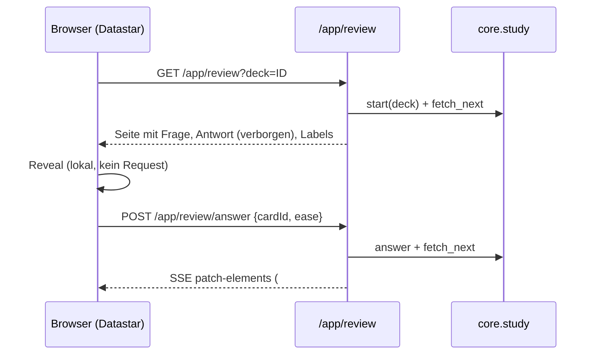

# Plan 3: Review-Ansicht und Flow (`/app/review`)

> Teil von [00-overview](2026-10-27-reviewer-redesign-00-overview.md). Voraussetzung: [Plan 1](2026-10-27-reviewer-redesign-01-independent-client.md) (Study-Kern, Session, Layout). Unabhängig von Plan 2 und 4.

**Ziel:** Reviewer nach `mockup.html`: HUD (Zurück, Streak, More), Fortschrittsbalken, Karten-Bühne, "Show Answer", vier Ease-Kacheln mit Intervall, Actions-Bottom-Sheet, Tastatur (Space, 1 bis 4). Karten kommen aus der echten v3-Queue; Rating läuft über den Study-Kern.

## Flow

**Reveal bleibt lokal:** Frage und Antwort stehen beim Laden schon im HTML (Antwort `hidden`); "Show Answer" schaltet per Datastar-Signal `revealed` um. Kein Round Trip, kein Latenzproblem auf Mobil (RESEARCH §6 nennt Latenz als Hauptnachteil). Das entspricht dem Mockup und `describe_next_states` liefert die Labels ohnehin schon mit der Karte.

## Entscheidungen

| Thema | Wahl | Begründung |
|---|---|---|
| Karten-HTML | `question_html`/`answer_html` aus dem Kern (sanitized) in `.flashcard` einsetzen | RESEARCH §3a Entscheidung |
| Stilisierung | Server-HTML trägt Klassen `.av-front-text`, `.av-hint`, `.av-back-text`, `.av-example` (DESIGN §5.F); sie werden in `app-client.css` per `@apply` mit Tailwind-Utilities gestylt, weil das Karten-HTML nicht im Template steuerbar ist. Alles andere: daisyUI/Tailwind im Template | DESIGN §5.F Stable Class Names |
| `*word*` → `<mark>` | Kleines Client-Skript `card-render.js`: arbeitet **nur** auf `.av-example` nach Einfügen. Text ist schon HTML-escaped, nur `<mark>` kommt hinzu | DESIGN §5.F ("Anki hat keinen Template-Filter") |
| Streak | **Aus dem Revlog abgeleitet (Entscheidung)**: Anzahl der letzten aufeinanderfolgenden Reviews mit Ease 2, 3 oder 4 seit Tagesbeginn (`day_cutoff - 86400`), **alle Decks**; Ease 1 beendet die Reihe. Nur Lesezugriff auf `revlog`, kein Schreiben, Server liefert den Wert in jedem Antwort-Fragment. Kein Signal, kein Client-Zustand | Überlebt Reload, Neustart und Gerätewechsel. Ändert DESIGN §2.A (dort: nur im Speicher), siehe Commit `Update DESIGN.md`. **Belegt (Probe):** `revlog.id` ist ms-Zeitstempel, eine Zeile pro Antwort; Reihe `[3,4,1,3,2,3]` → 3 (Mockup-Regel 2/3/4) |
| Fortschritt | Serverseitig aus Queue-Zählern: `done = start_total - (new+learning+review)` | Echte Zahlen statt Mockup-Konstanten `14/20`; `start_total` bei Session-Start gespeichert |
| Zeitmessung | `fetch_next` startet Timer, `answer` liest ihn (Plan 1) | Korrekte Antwortzeit (RESEARCH §11) |
| Zweite Tab / Reload | Reload ruft `POST`-artiges Start-Verhalten: `GET /app/review` **ist** ein Start, startet Timer neu (dokumentiert). Folgeaufrufe nur per POST | RESEARCH §11: Timer-Reset bei Reload ist bekannt |
| Seiteneffekte per GET | `GET /app/review` mutiert nur die Session (aktuelle Karte). Prefetch/Reload-Reset der Lesezeit akzeptiert; `Cache-Control: no-store` setzen | RESEARCH §11 Limit |

> **Hinweis zur Spike-Lehre:** `next` war im Spike ein GET mit Seiteneffekt. Hier ist die Seite selbst ein GET (Browser-Navigation, unvermeidbar bei Links aus Plan 2), jedes **Folge-Kommando** (answer, Aktionen) ist POST. `no-store` verhindert Prefetch-Cache. Kein separater JSON-`/next`.

## Task 0: Spike vor Implementierung (Queue-Filter, offen aus RESEARCH §3a.3)

> **Gate:** Task 0 läuft **vor** den Aufgaben 3.1 bis 3.4. Sein Ergebnis entscheidet, ob fremde Note-Types angezeigt oder gefiltert werden und prägt Template (Badge), Zähler und Tests. Nicht mit 3.1 beginnen, bevor das Ergebnis im Plan steht.

Offen und **ungeprüft** laut Recherche: Verhalten der Queue bei Decks mit gemischten Note-Types.
- [ ] Wegwerf-Collection: ein Deck mit 3 `AnkiWeb Vocab`-Noten und 3 `Basic`-Noten. `get_queued_cards` zeigt gemischte Karten? (erwartet: ja, Queue ist pro Deck).
- [ ] Prüfen, ob `col.sched` einen Such-Filter erlaubt (Custom-Study/Filtered-Deck mit `note:"AnkiWeb Vocab"` wäre ein Umweg, ändert aber Collection-State).
- [ ] **Default-Entscheidung, falls nicht lösbar:** Karten fremder Typen werden im neuen Client **angezeigt wie sie sind** (server-HTML, ohne Design-Klassen) statt versteckt, mit Hinweis-Badge "Other note type". Ausblenden würde Zähler und Queue verfälschen. Ergebnis im Plan-Dokument und in `DESIGN.md` §5.F nachtragen.
- Ergebnis blockiert Task 1 nicht; es steuert nur die Anzeige fremder Typen.

## Dateien

| Datei | Zweck |
|---|---|
| `core/app_client/study.py` | **erweitert:** `start(col, session, deck_id) -> StudyState` (mit `start_total`), Aktionen `toggle_mark`, `set_flag`, `bury`, `suspend`, `undo`, `set_due`, `delete_note`, `card_info_url` |
| `http_app/review.py` | Routen |
| `templates/app/review.html.jinja` | Seite |
| `templates/app/_review_stage.html.jinja` | `#stage`: Karte + Antwort + Badges |
| `templates/app/_review_bar.html.jinja` | `#bar`: Show-Answer oder Ease-Kacheln |
| `templates/app/_review_sheet.html.jinja` | Actions-Sheet |
| `static/app/card-render.js` | `*word*`-Highlight (nur `.av-example`) + Tastatur |
| `shell_src/app-client.css` | nur Eigenes: `.neo-press`, Keyframes (`streakPop`, `streakReset`, `revealAnswer`), Meter-Stripes, `.av-*`-Karten-Klassen |
| `tests/app_client/test_review_core.py`, `test_review_routes.py`, `test_review_browser.py` | |

## Routen

| Methode, Pfad | Zweck | Antwort |
|---|---|---|
| `GET /app/review?deck=<id>` | Start; Unbekannte oder fehlende ID → 303 `/app/`; Queue leer → Fertig-Zustand | HTML |
| `POST /app/review/answer` | Body (Datastar-Signale): `cardId`, `ease` | SSE: Stage, Bar, Progress oder Fertig |
| `POST /app/review/action/{name}` | `mark`, `flag`, `bury`, `suspend`, `undo`, `forget`, `delete` | SSE |
| `POST /app/review/due` | `cardId`, `spec` (z. B. `3`, `1-7`) | SSE; Fehler per `error_response` |
| `GET /app/review/info/{cardId}` | Card Info | 303 auf bestehende Card-Info-Seite (`/card-info/{ids}`, belegt `http_pages/card_info.py:935`) |

Alle POST: `cardId`-Check → `StaleCard` → 409 und Client lädt per `@get` die Seite neu. `ease` ∉ 1..4 → 422.

## Aufgaben

### 3.1 Kern-Aktionen (TDD, `temp_collection`)
Spiegeln `_ReviewerHandler` (belegt, `reviewer.py:330-440`), aber **ohne** Hub/WS und ohne Import aus `http_screens`:
- [ ] `toggle_mark` (Tag `marked`), `set_flag` (0..4), `bury` (Karte), `suspend` (Karte), `forget`, `set_due` (`col.sched.set_due_date([cid], spec)`), `delete_note`, `undo` (`col.undo()`, `UndoEmpty` → eigener `NothingToUndo`).
- [ ] Jede Aktion läuft über `service.run_op(..., initiator="app")` damit `OpChanges` an Subscriber gehen (wie alter Client; belegt `reviewer.py`). `initiator` wird nur durchgereicht; `BridgeHub.broadcast_opchanges` sendet an offene `/ws`-Kontexte (belegt `core/bridge/hub.py:41`), der neue Client öffnet keine, also wirkungslos. `/app/*` empfängt keine Hub-Events (`_send_all` sendet nur an registrierte `/ws`-Verbindungen, `hub.py:31`) und rendert daher nie auf eigene Schreibvorgänge neu; ein Initiator-Filter ist nicht nötig. Alte Tabs bekommen die Änderung (gewollt).
- [ ] Nach Bury/Suspend/Delete/Undo: `fetch_next` (wie alt: `_show_next`).
- Tests: je Aktion Zustand der Collection prüfen (Tag gesetzt, `queue == -1` bei suspend, usw.); `NothingToUndo` bei leerem Undo-Stack; ungültige `set_due`-Spec → `ValueError` mit Meldung.
- [ ] **Undo-Verhalten ungeprüft** (RESEARCH §8): Test, dass Undo nach Rating die Karte zurückbringt und Zähler wieder steigen. Schlägt er fehl → Aktion im Sheet ausblenden und im Plan vermerken, nicht stillschweigend lassen.

### 3.2 Seite und Fragmente
- [ ] `review.html.jinja`: `<body data-signals="{revealed: false, error: ''}">` (Gotcha #23). Alle Austausch-Ziele mit `id`: `#hud-progress`, `#stage`, `#bar`, `#sheet`.
- [ ] Antwort-Bereich `#answer-box` mit `data-show="$revealed"` und `style="display:none"` (Gotcha #4). Beim Kartenwechsel patcht der Server `revealed: false` per `patch-signals`.
- [ ] Show-Answer-Button: `data-on:click="$revealed = true"`. Ease-Kacheln: `data-on:click="@post('/app/review/answer')"` mit Signalen `cardId`/`ease` gesetzt vor dem Post (Gotcha #18: Geschwister-Signale): `data-on:click="$ease = 3; @post('/app/review/answer')"`. `;`-Ketten sind erlaubt, kein Block-Syntax (Gotcha #24).
- [ ] Tastatur: `data-on:keydown__window="..."` mit Ausdruck ohne Block: `evt.key === ' ' && !$revealed ? ($revealed = true) : ...`. Fokus-Guard wie Mockup (`closest('a, button, input, textarea, select, [contenteditable]')`) liegt zu lang für Inline-Ausdruck → **kleine Funktion** in `card-render.js` (`window.avKeydown(evt)`), vom Attribut aufgerufen (Gotcha #24: "delegate to window.fn()"). Datastar-Sandbox erreicht `window`-Funktionen über Delegation, das ist der dokumentierte Weg.
- [ ] Streak: reine Funktion `streak_from_revlog(rows) -> int` in `core/app_client/streak.py` (zählt rückwärts, solange `ease in {2,3,4}`), gespeist von `revlog.recent_eases(col, limit)` (Plan 1, 1.1b; Tagesgrenze nur dort). Die Funktion liest in Blöcken und bricht beim ersten Ease 1 ab. Die Rating-Antwort enthält `streak` (neu) und `streak_before`; der Client setzt Pop-Klasse bei Anstieg und Reset-Klasse bei Fall auf 0 (vollständige Klassennamen, `data-ts`-Neustart, Gotcha #19). Texte "Streak Reset! Don’t give up 💪" aus Mockup (über `s()`, Plan 6). **Undo:** `undo` löscht den Revlog-Eintrag, der Streak fällt damit automatisch zurück (Test).
- [ ] Progress: `#hud-progress` zeigt `done / total CARDS` und Balken `style="width: N%"`; Server liefert N.
- [ ] Fertig-Zustand: eigener Block "All done 🎉" mit Link `/app/`; zeigt den Streak des Tages unverändert weiter. Kein Redirect auf alten `/overview`.
- [ ] Sheet: Mode-Switch `Study | Add` (Add → `/app/add?deck=<id>`), 8 Aktionskacheln; **Card Info** als `<a>`; Rest als `@post`. Schließen: Backdrop-Klick, Dismiss, `Escape`. Fokus-Falle und `aria-modal="true"`, `role="dialog"` (im Mockup nicht belegt; **prüfen und ergänzen**).
- [ ] Mark/Flag-Zustand im Sheet-Label ("Unmark Card", "Remove Flag") kommt vom Server (Fragment `#sheet`).
- [ ] Fehler (`set_due` ungültig, Undo leer): `error_response` → Toast `#app-error` (Plan 1).

### 3.3 Styling mit daisyUI und Tailwind (Vorlage `mockup.html`)
- [ ] HUD: daisyUI `navbar` (Back = `btn btn-square`, Streak = `badge badge-lg` mit `data-class` für Pop/Reset, More = `btn btn-square`); Fortschritt = `progress` mit Stripes. Safe-Area oben per `pt-[env(safe-area-inset-top)]`.
- [ ] Karte: daisyUI `card` mit `rounded-box` und `neo-press`-Schatten; Deck-Tag und Mark/Flag als `badge`. Antwort-Block mit `revealAnswer`-Keyframe, `motion-reduce:animate-none`.
- [ ] Ease-Grid: `grid grid-cols-4 gap-2`, vier `btn` (`btn-error`, `btn-warning`, `btn-success`, `btn-info`) mit `neo-press`; Taste (`kbd kbd-xs`), Titel, Intervall (`font-mono`). Show-Answer = `btn btn-accent btn-block btn-lg` mit `kbd` SPACE. Unten `pb-[env(safe-area-inset-bottom)]`.
- [ ] Sheet: daisyUI `modal modal-bottom` mit `modal-box`; Öffnen/Schließen über Datastar-Signal `sheetOpen` und `data-class:modal-open="$sheetOpen"` (vollständiger Klassenname). Tiles = `btn` im `grid grid-cols-2`, Delete = `btn-error btn-outline`. Mode-Switch = daisyUI `join` mit zwei `btn` (`btn-active` für aktuell) und `aria-current`. Backdrop-Klick: `modal-backdrop` als `<form method="dialog">`-freies Element mit `data-on:click="$sheetOpen = false"`. Hinweis: native `<dialog>`/`showModal` ist **nicht** nötig; `modal-open` genügt und vermeidet Block-JS (Gotcha #24).
- [ ] Toast = daisyUI `toast toast-top toast-center` mit `alert`.
- [ ] Ease-Kontrast gemessen (Plan 1, 1.0) in beiden Themes; Streak-Text (`--color-streak-text` im Mockup) als `text-warning-content` oder eigener Theme-Wert, Messung entscheidet.
- [ ] `motion-reduce:` für Streak, Reveal, Meter.

### 3.4 Tests
Routen (`TestClient`, Collection mit 3 Karten):
- [ ] `GET` setzt Timer; Seite enthält Frage, Antwort (in `#answer-box`), vier Labels ohne U+2068/2069.
- [ ] `POST answer` ease 3: SSE enthält `datastar-patch-elements` für `#stage`; Zähler sinkt; Review-Log hat Eintrag (`col.db.scalar("select count() from revlog")`).
- [ ] Falsche `cardId` → 409; ease 0/5 → 422; unbekannte Aktion → 404.
- [ ] Leere Queue → Fertig-Block.
- [ ] XSS: Feldwert `` erscheint nicht als ausführbares Tag (sanitize), `*x*` im Example wird `<mark>`, `<b>` bleibt escaped.
- [ ] Passwort-Gate: 303.
- [ ] Zeitmessung über HTTP: `sleep(0.05)` zwischen GET und POST, Revlog-`time` ≥ 40.
- [ ] `Cache-Control: no-store` auf `GET /app/review`.

Browser (Playwright, `importorskip`):
- [ ] Space deckt auf, `1`..`4` bewertet, Streak steigt/fällt, Again zeigt Reset-Toast, **Reload behält den Streak**, Undo senkt ihn.
- [ ] Space/Ziffern im Fokus eines Buttons ignoriert (Guard).
- [ ] Sheet öffnen, Backdrop schließt, Escape schließt.
- [ ] Bury/Suspend entfernt Karte; Undo bringt Rating zurück.
- [ ] Kein horizontaler Scroll bei 375 px; keine Konsolenfehler; hell/dunkel Screenshot.

## Akzeptanz
- Vollständiger Lernlauf über die echte Queue bis "All done", Zähler und Revlog stimmen.
- Alle 8 Sheet-Aktionen funktionieren oder sind begründet ausgeblendet (Undo-Vorbehalt).
- Reveal ohne Netzwerk-Request (DevTools/Playwright `request`-Listener: 0 Requests zwischen Laden und Rating).
- Kein Verweis auf `reviewer.js`, `/ws`, `/_anki/` (Isolations-Test).

## Risiken
| Risiko | Gegenmaßnahme |
|---|---|
| `data-class` mit dynamisch gebautem Klassennamen wird von Tailwind nicht erkannt | nur vollständige Namen (`modal-open`, `animate-streak-pop`) |
| daisyUI-`modal` ohne `<dialog>` hat keine Fokus-Falle | Fokus-Falle und Escape in `window.avSheetKey` (Delegation), `aria-modal`/`role="dialog"` setzen, im Browser-Test prüfen |
| Streak-Abfrage bei sehr langen Reihen (hunderte Reviews) | Abfrage bricht beim ersten Ease 1 ab; Test mit 500 Einträgen und Zeitmessung |
| Antwort steht im HTML vor Reveal (Spoiler im Quelltext) | Akzeptiert (Single-User-Lernapp, kein Wettbewerb); in Doku vermerken |
| Fremde Note-Types brechen Layout | Task 0 Default (Anzeige "wie sie sind" + Badge) |
| `run_op` broadcastet an offene alte Tabs | gewollt (hält alten Client aktuell), kein Handler nötig |
| MathJax in Karten | **Out of Scope** (dedizierter Typ ohne Math, RESEARCH §3a); Doku-Hinweis |

## Commits
1. `Add study core actions: mark, flag, bury, suspend, due, delete, undo`
2. `Add /app/review page and answer route`
3. `Add review fragments: stage, bar, progress, finished state`
4. `Add card-render.js: example highlight and keyboard guard`
5. `Add actions sheet and action routes`
6. `Style review with daisyUI and tailwind incl. reduced motion and safe areas`
7. `Add review route and browser tests`
8. `Record queue filter spike result in DESIGN.md`

## Datastar-Syntax: belegt vs. im Smoke zu prüfen

| Verwendung | Status | Quelle (Skill-Referenzen) |
|---|---|---|
| `data-on:keydown__window`, `evt`, `el` in Ausdrücken | belegt | `references/guide-core.md:33,185`, `attributes.md:117` |
| Signale mit `_`-Präfix werden nicht gesendet | belegt | `references/guide-core.md:137`, `gotchas.md` #1 |
| `@post` ohne Block, `;`-Ketten | belegt | `gotchas.md` #24 |
| `if(...)`-Einzeiler wie in `guide-core.md:33` | **widersprüchlich** zu Gotcha #24 | nicht verwenden; Ternär oder `window.fn()` |
| Streak aus Revlog (Regel 2/3/4, Tagesgrenze, Undo) | Probe belegt für Reihenfolge und Zeitstempel; **Undo-Verhalten und 500-Einträge-Laufzeit ungeprüft** | Tests in Plan 3 |
| Animation-Neustart via `data-ts` | belegt (Gotcha #19), Details im Smoke prüfen | `gotchas.md` #19 |
